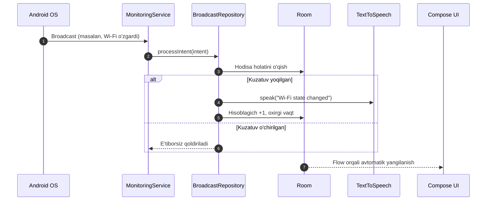
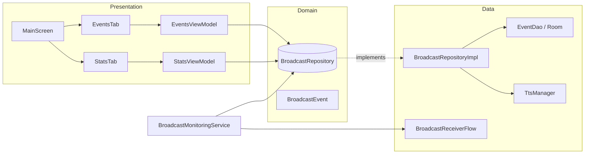

<div align="center">

# 📡 EventApp

**Tizim hodisalari Android ilovasi: Wi-Fi, Bluetooth, zaryadlovchi va boshqa o'zgarishlarni real vaqtda kuzating, ovozli e'lon eshiting va statistikani saqlang.**


</div>

---

## 📖 Loyiha haqida

**EventApp** — Android qurilmasidagi tizim hodisalarini fon rejimida kuzatib boruvchi ilova. Foydalanuvchi har bir hodisa (Wi-Fi, Bluetooth, Airplane Mode, zaryadlovchi, quloqchin va h.k.) uchun kuzatuvni alohida yoqishi yoki o'chirishi, hodisa sodir bo'lganda ovozli e'lon (Text-to-Speech) eshitishi hamda hodisalar soni va oxirgi qabul qilingan vaqtni **Stats** bo'limida ko'rishi mumkin.

Loyiha zamonaviy Android texnologiyalari — **Jetpack Compose**, **Hilt**, **Room**, **Kotlin Flow** va **Clean Architecture** asosida yozilgan.

[Imkoniyatlar](#-imkoniyatlar) · [Skrinshotlar](#-skrinshotlar) · [Qanday ishlaydi](#-qanday-ishlaydi) · [Arxitektura](#-arxitektura) · [Ishga tushirish](#-ishga-tushirish)

---

## ✨ Imkoniyatlar

| | |
|---|---|
| 🔔 **Real vaqt monitoringi** | Wi-Fi, Bluetooth, zaryadlovchi, quloqchin va boshqa 12+ tizim hodisasi |
| 🗣️ **Ovozli e'lon** | Hodisa sodir bo'lganda `TextToSpeech` orqali ovoz chiqaradi |
| 🎚️ **Alohida boshqaruv** | Har bir hodisa uchun kuzatuvni yoqish / o'chirish mumkin |
| 📊 **Statistika** | Hodisalar soni va oxirgi qabul qilingan vaqt |
| 💾 **Doimiy xotira** | Holat Room bazasida saqlanadi, ilova qayta ochilsa ham yo'qolmaydi |
| 🧩 **Fon rejimi** | Foreground Service tufayli ilova yopilganda ham ishlaydi |
| 🎨 **Zamonaviy UI** | 100% Jetpack Compose + Material 3, edge-to-edge |

## 📱 Skrinshotlar

<p align="center">
  
  
</p>

## 🔍 Kuzatiladigan hodisalar

<details open>
<summary><b>To'liq ro'yxat</b></summary>

| Hodisa | Action |
|---|---|
| 📶 Wi-Fi | `android.net.wifi.WIFI_STATE_CHANGED` |
| 🔵 Bluetooth | `android.bluetooth.adapter.action.STATE_CHANGED` |
| ✈️ Airplane Mode | `ACTION_AIRPLANE_MODE_CHANGED` |
| 🌐 Internet | `android.net.conn.CONNECTIVITY_CHANGE` |
| 📍 Location | `android.location.PROVIDERS_CHANGED` |
| 🔌 Zaryadlovchi | `ACTION_POWER_CONNECTED` / `ACTION_POWER_DISCONNECTED` |
| 🎧 Quloqchin | `ACTION_HEADSET_PLUG` |
| 🪫 Batareya past | `ACTION_BATTERY_LOW` / `ACTION_BATTERY_OKAY` |
| 🔋 Battery Saver | `android.os.action.POWER_SAVE_MODE_CHANGED` |
| 🔕 Silent rejim | `android.media.RINGER_MODE_CHANGED` |
| ⛔ Do Not Disturb | `android.app.action.INTERRUPTION_FILTER_CHANGED` |
| 🔗 USB | `android.hardware.usb.action.USB_DEVICE_ATTACHED` |

</details>

## ⚙️ Qanday ishlaydi



## 🏗️ Arxitektura

Loyiha **Clean Architecture** va **MVVM** tamoyillariga asoslangan:



<details>
<summary><b>📁 Loyiha tuzilishi</b></summary>

```
app/src/main/java/com/abdullojon/eventapp/
├── MainActivity.kt                 # Kirish nuqtasi
├── app/MyApp.kt                    # @HiltAndroidApp
├── data/
│   ├── MockData.kt                 # Boshlang'ich hodisalar
│   ├── local/                      # AppDatabase, EventDao, EventStateEntity
│   ├── receiver/                   # BroadcastReceiver → Flow
│   └── repository/                 # BroadcastRepositoryImpl
├── domain/
│   ├── model/                      # BroadcastEvent, EventIconType
│   └── repository/                 # BroadcastRepository
├── di/DatabaseModule.kt            # Hilt moduli
├── service/                        # BroadcastMonitoringService
├── util/TtsManager.kt              # TextToSpeech o'rami
├── presentation/
│   ├── main/                       # Tab navigatsiya
│   ├── events/                     # Hodisalar ro'yxati
│   ├── stats/                      # Statistika
│   └── components/                 # Umumiy UI
└── ui/theme/                       # Color, Type, Theme
```

</details>

## 🧰 Texnologiyalar

| Yo'nalish | Stack |
|---|---|
| **Til** | Kotlin 2.2 |
| **UI** | Jetpack Compose, Material 3, Icons Extended |
| **Navigatsiya** | Voyager (Navigator + TabNavigator) |
| **DI** | Hilt + KSP |
| **Baza** | Room 2.8 |
| **Asinxronlik** | Coroutines, Flow, StateFlow |
| **Ovoz** | Android TextToSpeech |
| **Qo'shimcha** | Orbit MVI, Coil, Timber, Chucker (debug), SplashScreen API |

> [!NOTE]
> Retrofit, OkHttp va Gson loyihaga qo'shilgan, lekin hozircha tarmoq so'rovlari ishlatilmaydi.

## 📋 Talablar

- Android Studio (so'nggi barqaror versiya)
- JDK 11+
- Android SDK: `compileSdk 37` · `targetSdk 36` · `minSdk 24`
- Android Gradle Plugin `9.2.1`

## 🚀 Ishga tushirish

Yoki Android Studio'da: **Open** → Gradle sync → **Run ▶**

## 🔐 Ruxsatlar

| Ruxsat | Nima uchun |
|---|---|
| `FOREGROUND_SERVICE` · `FOREGROUND_SERVICE_SPECIAL_USE` | Fon rejimida tinglash |
| `RECEIVE_BOOT_COMPLETED` | Qurilma yoqilganda ishga tushish |
| `ACCESS_NETWORK_STATE` · `ACCESS_WIFI_STATE` | Tarmoq holati |
| `BLUETOOTH` | Bluetooth holati |

> [!TIP]
> Android 13+ da doimiy bildirishnoma ko'rinishi uchun `POST_NOTIFICATIONS` ruxsati kerak bo'lishi mumkin.

## 👤 Muallif

**Abdullojon Farmonov**

**farmonovabdullojon04@gmail.com**

---

<div align="center">
<sub>Foydali bo'lsa, ⭐ qo'yishni unutmang!</sub>
</div>
